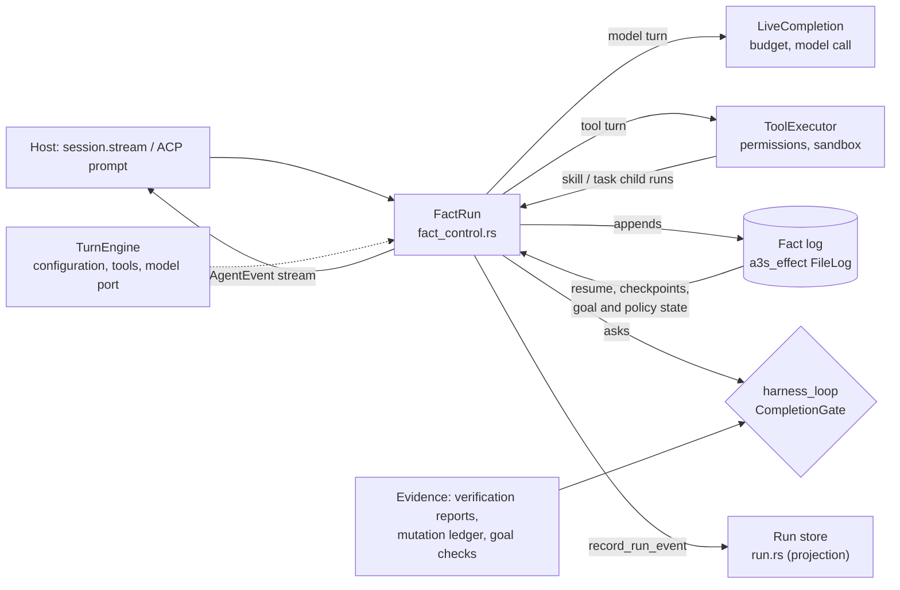

# Core concepts and their single authorities

CORE-VOCAB1. One page: for each core concept, the one place that decides it,
and what only projects or supplies evidence. Paths are relative to
`apps/code/core/src/`. Ratchet tests in `core/tests/` hold the rules that
can be checked mechanically.

## Run flow

## Authority table

| Concept | Single authority | Projections and evidence suppliers | Enforced by |
| --- | --- | --- | --- |
| A run is complete | `harness_loop::decide_completion` / `decide_with_observations`, the only producer of `CompletionGate::Allow` | Verification reports, the mutation ledger and completion waivers are evidence. `goal_control` and `planning` never decide; they read a verdict. `AgentEvent::GoalAchieved` is emitted only after a gated plan (`agent/planning_runtime.rs`) and redacted in `security/mod.rs`. Durable goal evidence (`fact_control/goal_evidence.rs`) asks `should_emit_goal_achieved*` only after the gate allowed. | `core/tests/completion_authority.rs` |
| Run history | The fact log: `a3s_effect` facts in the session `FileLog` (`fact_control.rs`, `log_dir`) | Resume, checkpoints, work policy and goal state are folded from it (`validate_durable_source`, `checkpoints`, `work_policy::prepare_policy`, `goal_control::prepare_run`). The run store (`run::InMemoryRunStore`, the "run journal") is a bounded, FIFO-evicted projection fed by `record_run_event`. The `AgentEvent` stream is the live projection. `CoreEventLog` (`core_event_log.rs`) is an optional digest-only chain for hosts; production session runs do not write it. | Fact-log replay tests in `fact_control_tests.rs` |
| Model turns | `FactRun` for sessions and `skill` / `task` child runs | `TurnEngine` supplies the admitted configuration, tools and model port. The old standalone/planning routes are test-only; remaining crate-private legacy entry sites are pinned. | `core/tests/turn_engine_entries.rs` (shrink-only) |
| Permission for a shell command | `permissions::shell::analyze` (one parsed classifier) | Policy rules, the interactive guardrail, the verifier turn and ACP approval learning all read its analysis. | `core/tests/shell_bypass_corpus.rs` |

## Budgets

There is no single `Budget` type yet. Each dimension has one owner. The
table records where the two turn engines still differ.

| Dimension | Unit | Configured by | Enforced on the FactRun path | Enforced on the AgentLoop path |
| --- | --- | --- | --- | --- |
| Wall clock per run | ms | `SessionOptions::max_execution_time_ms` | `LiveCompletion` (CORE-DEADLINE1) | `agent/llm_turn.rs` |
| Tool rounds | rounds | `max_tool_rounds` (`/effort`) | `HarnessConfig` round cap; step limit is 4 × rounds, at least 32 | `ExecutionLoopState::turn_limit_error` |
| Model attempts per call | attempts | harness `model_attempts` (default 2) | `a3s_effect` fold | `circuit_breaker_threshold` (not read by FactRun) |
| Continuation segments | segments | `max_continuation_turns` | not read; the completion gate decides | `agent/completion_runtime.rs` |
| Provider quiet gap | ms | `llm_api_timeout_ms` | `fact_control/model_wait.rs` | `agent/llm_turn.rs` |
| One tool call | ms | `tool_timeout_ms` | not verified: `fact_control.rs` never reads it; tools may bound themselves | `agent/tool_execution_runtime.rs` |
| Repeated identical calls | count | `duplicate_tool_call_threshold` | `HarnessConfig::with_duplicate_threshold` | `ExecutionLoopState` |
| Read-only evidence | calls | built-in ceiling | `read_only_evidence_exhausted_with_calls` | `ExecutionLoopState::read_only_evidence_exhausted` |
| Context size | tokens or chars | `max_context_tokens`, `auto_compact_threshold` | fact compactor (`fact_compact_after_*`) | `maybe_auto_compact` |
| Host quota | host-defined resource | `BudgetGuard` (`budget.rs`) | `fact_budget_gate` before each model call | the same guard |
| Workflow tokens | tokens | `WorkflowBudget` (`orchestration/workflow_budget.rs`) | not applicable (workflows only) | not applicable |
| Retrieved context | items, tokens | `ContextBudget` (`context/assembler.rs`) | context assembly | context assembly |

## Rules

- A new completion source supplies evidence to the gate; it does not emit
  a verdict or `GoalAchieved` of its own.
- A new durable store is a projection of the fact log, or it says in its
  module doc why it is not.
- A new run path goes through `FactRun`. The legacy entry list may only
  shrink.
- A new limit names its dimension in the budget table and is enforced on
  the FactRun path.
