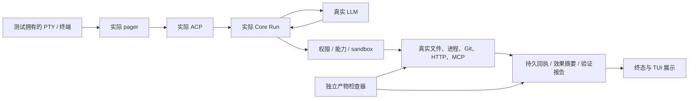

# A3S Code TUI 全功能端到端测试计划

日期：2026-10-12。对象：产品启动链 **`a3s code → a3s-code-tui → a3s-code-acp → Code Core`**，以及这一启动链实际开放的工具与宿主能力。当前仓库候选为 9.1.3。**本交付是规划，不是执行报告，也不是发布资格证明。**

目的：证明用户可以持续完成编码任务，并在拒绝、故障、取消、重启后获得准确的状态。针对“每个 turn 都报错”，首先证明已知未执行的拒绝不会污染下一轮，同时真实未知副作用仍保持 fail closed。

## 1. 交付与范围

| 文档 | 内容 | 功能/限制项 | 用例 |
| --- | --- | ---: | ---: |
| [行为用例](behavior-cases.md) | 输入、会话、模型、执行、工具、扩展、显示、恢复、安全与耐久 | 108 | 545 |
| [设置用例](settings-cases.md) | 34 个可见设置 + 18 个隐藏设置的限制检查 | 52 | 260 |
| [禁用命令用例](unavailable-cases.md) | 当前 Code 后端明确禁用的 42 个命令，包含导入菜单限制 | 42 | 215 |
| **总计** | 每项至少有 5 条独立编号用例 | **202** | **1,020** |

[入口映射](coverage.md)逐项关联 **75 个内置命令、1 个 ACP 动态命令 `/goal`、52 个设置、72 个 ActionId**。命令别名归入同一功能，不重复充数。一个操作族内的不同枚举值、平台按键、文件编码仍须参数化执行；这些组合没有膨胀为本表额外用例。

[模型工具映射](tool-coverage.md)另列 **23 个精确工具名**，包括条件开放的代码服务；逐项关联现有功能用例，不重复计数。运行时新增的 MCP/插件工具须单独补行，每项至少 5 例。

[机器可读用例目录](catalog.json)保存每条用例的前置、步骤、判据、通道、证据和状态；它是测试数据，不是产品配置。[源码入口快照](inventory.json)记录关键文件摘要和 Git HEAD。这里不是第二份 SDK capability id 清单；SDK 主目录仍由 `sdk_capabilities()` 和 [原测试目录](../../test-cases/README.md)管理。

[三角色评审与测试排期](review-guide.md)汇总 11 个功能域、每个角色的具体验收责任、当前轮次报错的五条关键反证，以及六个实施包的依赖和退出条件。

[选定用例执行状态](execution-status.md)另记真实运行结果。最新请求终结驱动使用同一冻结候选，完整十条真实 LLM 门禁连续三次 **10/10**；四次编码请求分别绑定独立 Run，部分检查实际退出 1，后两次获得绑定当前效果的 Verified。此前 8/2、9/1 和 SOLO 结果分别保留。此结果只覆盖选定门禁；计划目录的 PLANNED 状态不充当执行通过率，完整 P0、1,020 条目录及平台/模型矩阵尚未通过。

后续已用实际 A3S Test ACL 引擎执行直接 Bash/background 拒绝后恢复，各连续三次通过；任务文件变体仍有省略所需工具调用的失败，单独保留。见 [ACL 引擎证据](../../../../../docs/evidence/code-harness/20261012-tui-acl-native-refusal/OUTCOME.md)。RT10-03/04/05 的真实故障场景继续开放，篡改证据副本不算这些场景已执行。

实际启动观察发现欢迎页还有独立分发入口。已把 worktree 菜单五例归入 TL23、旧设置导入菜单五例归入 GT27，并新增本地 Changelog 五例 UI16，共补充 15 例。Resume、Quit 和反馈提示也已映射到原功能。它们均保持 PLANNED；启动视口只证明入口显示，不证明功能通过。Changelog 的合法 A3S 数据来源和导入入口的条件可达性仍需核实。

### 范围边界

- **当前可用**：本地 TUI 动作、ACP 开放的 session/model/mode/goal/compact，以及模型实际可见并可执行的工具。
- **需要配置**：真实启动链开放的技能、子代理、MCP、语义检索等；必须通过产品启动链启用。不能在 Rust 测试里注入私有对象后声称用户能通过 TUI 使用。
- **当前禁用**：42 个命令与 18 个设置只验收入口拒绝。这 305 条限制用例不能作为其正向功能可用的证明。
- `/resume` 禁用与启动 `--resume`/`--continue` 支持是两个入口；分别验收。`/plan` 是上游套餐命令，不能与 Shift+Tab 的 Plan 姿态混淆。
- `/skills`、`/mcps` 管理界面禁用，不自动等于模型侧 `Skill`、`search_skills`、已授权 MCP 工具不可用。
- `/cd` 虽出现在 effective contract，源码标记 dashboard-only；Code 又禁用 dashboard。因此单列 UI13 检查真实限制，不能据“effective”字样宣称可切目录。
- 语音命令禁用但部分语音设置仍可能可见：UI14 与对应设置检查快捷键、麦克风、网络是否旁路能力门。这是高风险待实测项。
- Code Intelligence、持久记忆、语义检索等列为条件项；若正式 ACP 启动链无法供给所需宿主，正向用例记 BLOCKED，并记录责任入口。SDK 的单独通过不能代替它。
- `program`、动态 workflow、state graph、S3、遥测、研究 API、Cloud/VM/Box 管理与上游收费/账号服务，不凭 Core 存在 API 就列为 TUI 已开放。若运行时真实广告新增入口，必须先补该功能至少 5 条用例再关闭覆盖审计。

**完整性边界**：这是当前已盘点源码入口的映射与预期行为计划；运行前还必须核对实际握手、菜单、工具 schema 和宿主配置。动态能力集合没有固定上限，不能把静态 1,020 条永久当成“所有版本、所有插件均覆盖”。

## 2. 三个角色的验收责任

| 角色 | 关注问题 | 本计划的可核对要求 |
| --- | --- | --- |
| 架构师 | 权威在哪里，副作用归谁，何时可以结束 | session/run/turn/generation/invocation 身份完整；权限、sandbox、宿主能力不可旁路；持久化与终态一致；未知效果不能由文本或普通豁免结算 |
| 产品经理 | 用户是否完成目标，失败后能否继续 | 实际入口可发现、状态与效果一致、明确不可用原因、草稿不丢、错误可恢复；计划/取消/重试的后续行为可解释；无假成功 |
| 测试工程师 | 能否重复、反证和定位失败 | 独占夹具、真实 PTY 操作、真实 LLM、独立产物判据、边界和故障注入、精确清理、保留失败证据；每项至少 5 条 |

每项功能均给出源码入口、产品入口、夹具、优先级和五条具体操作/判据。它们共同构成三视角检查，而不是三个重复清单。

## 3. 端到端边界与执行通道

| 通道 | 必须真实经过的链 | 使用原则 |
| --- | --- | --- |
| `U` | 正式 pager + ACP，实际本地 UI/存储/系统能力 | 主题、复制等不需要模型决策时检查新增模型请求=0；不要为凑“真实 LLM”产生无意义调用 |
| `L` | pager → ACP → Core →真实 LLM→实际工具/存储→终态 | 编码、多轮、计划、工具选择、技能、委派等；mock 不能替代验收 |
| `H` | 上述真实链 + 测试拥有的故障代理/进程故障 | 可丢包、延迟、截断连接；不得用预置模型答案替换真实决策 |
| `C` | 先证明正式启动链确实开放该能力，再走真实链 | 无能力则记录拒绝与正向 BLOCKED；不能偷偷改成 SDK/模拟宿主通过 |
| `G` | 实际 TUI 限制与分发路径 | 明确拒绝、零新增模型请求、零禁止的文件/进程/外部服务副作用 |

确定性孪生用于 schema、时序和罕见故障定位；单列结果，不能计算为真实 LLM 通过。UI-only 用例与模型行为用例分开统计。

## 4. 所有用例共同前置

1. 固定同一候选的 CLI/pager/ACP/Core 组合；记录路径、版本、构建 profile、特性、Git HEAD、dirty patch 摘要、二进制 SHA-256。仓库当前共享且有未提交修改；HEAD 本身不足以标识候选。
2. 每个场景创建独占工作区、测试产品 home 和 PTY；通过子进程环境隔离用户目录，不能改操作者真实 HOME，也不能在共享仓库运行破坏性 Git 用例。
3. 只用 **A3S ACL** 创建产品配置，并用 `a3s-acl` 解析/生成；保存初始与最终摘要。机读 JSON 报告与目录只是测试数据，不作为产品配置读取。
4. 真实 LLM 预检确认 provider、实际 model id、连接和预算；记录请求次数/token usage。认证不足、缺凭证、quota、模型不可用必须给非通过状态，不能 early-return 伪绿。模型具体 id 从本次有效 ACL 选取，不硬编码不存在的别名。
5. 采集初始工作区摘要、Git HEAD/index、拥有进程树和外部 sentinel。权限先按默认姿态运行，再跑 Plan/YOLO；每次变更需要宿主接受值作证。
6. 用随机 canary 区分夹具与模型猜测；用于检验读回/检索的答案不能直接写进提示。复杂编码任务使用独立 checker，模型不得修改 checker。
7. 为故障场景预先声明 deadline、故障时点、清理上限。使用状态/事件等待；不用固定 sleep 判断产品完成。
8. 报告执行资格：操作系统/架构、终端类型、终端能力、屏幕尺寸、真实能力 schema 与配置。被平台安全门拒绝的命令正向场景不具资格，不能用放宽权限补成通过。

## 5. 夹具规格

每个具体目录都由场景创建和销毁；以下名称是 `catalog.json` 的夹具合同，不表示仓库已实现这些夹具工厂。

| 夹具族 | 必须构造的内容与独立判据 |
| --- | --- |
| `clean-home`、`acl-layers`、`catalog` | 无用户秘密的隔离 home；显式/个人/工作区 ACL 冲突、畸形/超限/FIFO/链接负例；受控 provider 请求计数 |
| `unicode-input`、`multiline`、`drafts` | 中文、emoji、组合字符、CRLF、多行代码、控制序列、大小边界；保存精确提交文本与光标状态 |
| `random-marker`、`workspace-files` | 现场随机标记；空、缺失、二进制、超大、FIFO、链接与越界 sentinel；初始文件摘要清单 |
| `dual-defect-checker`、`verification-contract`、`patch-corpus` | 两个独立缺陷；只修一个仍失败；checker 源码摘要锁定；真实 fail→partial-fail→pass 日志；当前效果摘要的验证绑定 |
| `attachment-fixtures`、`instruction-chain`、`two-workspaces` | 文件/图片附件、未绑定占位符、个人/项目/嵌套 AGENTS 优先级、两个隔离项目；精确内容与禁止泄漏 canary |
| `backend-gates`、`terminal-outcomes` | 当前后端禁用目录、别名与快捷键；Verified/Failed/Cancelled/截断/预算终态样本；限制动作前后请求计数与副作用基线 |
| `two-sessions`、`durable-sessions`、`durable-goal` | 两个唯一标记会话；另一工作区同名文件；有效/损坏/未结算历史；目标暂停、清除与恢复的持久状态 |
| `long-transcript`、`rich-transcript`、`large-context`、`stream-fixtures` | 多轮、长单行、十万行工具输出、表格/差异/图；流式/截断/压缩触发；有界保存原片段与身份 |
| `config-draft`、`two-real-models`、`effort-models`、`secret-canary` | 两个真实 provider/model 路由（不能支持时相应场景 BLOCKED）；同名展示项、env 引用、模型级覆盖、无效参数、只读文件与并发写冲突 |
| `permission-fixtures`、`question-form`、`planning` | 可允许/必须拒绝动作；双会话审批；必填与可选表单；真实计划状态；声明式缩短 deadline 的测试专用配置 |
| `native-refusal`、`qualified-native`、`owned-process`、`fault-ledger` | 已知预执行拒绝；实际开始后的未知结果；stdin、stdout/stderr、后代树、忽略终止信号；另起不归本测试所有的 sentinel 进程 |
| `search-corpus`、`semantic-runtime` | 同名/同义/无关文档、路径过滤、更新删除；预先人工标注相关性与排名阈值；真实索引/embedding 及版本 |
| `disposable-git` | 独占临时仓库与两个 worktree；固定提交、暂存/未跟踪/脏文件、冲突、stash、含秘密 canary 的 remote；禁止操作共享仓库 |
| `welcome-release-notes` | 固定合法 A3S 版本、发布数据来源和能力合同；空/损坏/离线缓存、慢响应、长 Markdown 和控制字符；不得把上游收费产品数据冒充 A3S 数据 |
| `controlled-public-http`、`controlled-search` | 测试拥有的公开端点；唯一标记、摘要、重定向、大/慢响应；禁区 sentinel 端点应收到零次请求。不能为测试关闭 SSRF/私网安全门 |
| `fixture-skill-pack`、`fixture-agent-pack`、`memory-profile` | 通过产品允许目录/ACL 开放；固定技能工具限制、agent 身份、代际变更、真实记忆写入/提交/Active-only scope；不能仅注入 SDK 对象 |
| `fixture-mcp`、`code-intelligence-host` | 实际产品已授权的 MCP stdio/HTTP/SSE 与语言服务；协议错误、progress、目录变化、用户同意、UTF-16 位置；每条 wire 请求可核对 |
| `settings-fixtures`、`terminal-themes`、`terminal-mouse`、`terminal-variants`、`kitty-terminal` | 全量设置、只读配置、取消预览；明暗/鼠标/图形/SSH/tmux/备用键码；原终端模式快照 |
| `isolated-clipboard`、`export-paths`、`fake-open-process`、`fake-editor-process`、`fake-audio-host` | 隔离剪贴板和本测试系统调用捕获；真实拥有的 editor/open 进程；禁止实际上传/录音；只替换外部副作用接收端，不替换产品分发/审批 |
| `slow-real-turn`、`mixed-tool-batch`、`object-schema`、`sandbox-policy`、`soak-workspace` | 真实模型 + 可控延迟；混合工具逐项回执；独立 schema 验证；网络/写入边界；资源计量与稳定时钟 |

## 6. 通过判据与证据

编码验收须先核实正式 TUI 启动链如何声明“检查命令及覆盖文件”的宿主合同。Core 的 `VerificationContractV1` SDK 注入能力不能替代这个入口；当前 `/goal <objective>` 不直接创建机器验收合同；应使用正式宿主 ACL 的 `verification_contract`，并先完成其实际入口资格验证。若合同或执行资格未通过，正向验证资格保留未通过，并记录具体原因。不得手写旧 loop 的 ACCEPTANCE 文件、使用私有测试注入或把 exit 0 等同于当前变更已 Verified。

**三层同时核对**：界面是否准确 → 真实协议/Run/工具事实是否一致 → 磁盘、Git、HTTP、存储或进程是否确实产生预期效果。模型正文、屏幕关键字、测试自己写出的标记都不能单独当成功证据。

每条编号用例至少留存：

- `result`：状态、开始结束时间、实际步骤、失败点、重试记录、平台/profile/model。
- `terminal`：最小必要 VT/语义视口、焦点和终端模式；敏感窗口原始内容仅在受控本地保留，脱敏后才外传。不能先公开原 VT 再声称事后脱敏。
- `timeline`：脱敏 ACP 请求/通知、session/run/turn/generation/invocation id、模型真实请求数、token usage、工具起止、typed outcome、终态。
- `artifacts`：before/after 摘要、checker 原文摘要与真实退出码、验证报告绑定、效果完整性、进程树清理结果、网络 sentinel 计数。
- `candidate`：源码/patch/配置/二进制指纹与实际工具目录；原凭证不复制进证据。

结果枚举为 `PASS / FAIL_PRODUCT / FAIL_SPEC / FAIL_INFRA / BLOCKED / NOT_RUN / N/A(reason)`。失败后再通过不抹掉原失败；记录单次、重跑与真实成功率。`N/A` 只用于已经证明入口不可达的具体参数化，不可用来掩盖一个当前开放功能没有测试。

`tool_effect_unresolved` 的特有反证：已知未开始应是 `Denied + Complete + zero effects` 并能继续下一轮；已经 dispatch 或 hook 已写入后无法证明结果，则必须保留 `Unknown/Incomplete` 与对应身份，不能凭同样报错文字消债。旧会话已有真实 Unknown 的修复另需身份绑定结算，本计划不允许直接删历史。

## 7. 平台、模型与参数矩阵

| 维度 | 必须覆盖的组合 | 约束 |
| --- | --- | --- |
| 平台 | macOS arm64、Linux x86_64、Windows x86_64（以发布支持声明为准） | 没有实际机器/runner 就 BLOCKED；不从另一平台测试推断通过 |
| native 执行 | 已资格合格平台正向；macOS 当前未合格路径拒绝 | 原生后代生命周期未合格时不关闭 fail-closed；Linux/Windows 也须单独证明，不假定合格 |
| 模型协议 | 当前真实 Anthropic-compatible、OpenAI-compatible 及实际发布支持的其他 adapter | 不因供应商名称推断 wire 协议；记录真实 adapter 和 model id |
| 推理与能力 | 有原生 effort / 宿主预算；有/无 tool_call；图像只按握手能力 | 没有支持就负向拒绝或 BLOCKED，不假装 provider 支持 |
| 权限 | default、Plan、YOLO；宿主明确 deny | YOLO 不取消 sandbox、能力门、身份结算或验证门 |
| 终端 | fullscreen、minimal、inline（实际仍支持时）、80x24/120x40/40x12；SSH/tmux/VS Code/图形支持 | 本地语义 PTY 不能替代所有真实终端的鼠标/剪贴板/渲染资格 |
| 文件/规模 | UTF-8/CRLF/中文/空格/链接/FIFO/大文件/大输出/大历史 | 边界从源码 schema/limits 获取，固定到候选；不随失败随意调阈值 |
| 并发/恢复 | 双会话、并行他人提交、模型切换、重连、重启、取消晚到事件 | 全部按实际拥有身份断言，不按进程名称批量杀进程 |

每条基础用例先在主发布 profile 执行一次。P0 的模型链在两个真实 adapter 上各至少三次；平台相关 P0 在每个发布平台执行。然后对姿态×模式×规模做风险驱动的 pairwise；涉及权限、结算、重放的关键组合不能用 pairwise 省掉明确负例。矩阵的展开结果独立报告；1,020 是基础用例数，不是运行次数。

## 8. 执行顺序、责任与退出条件

| 阶段 | 主要用例 | 交付责任 | 退出条件 |
| --- | --- | --- | --- |
| 0：入口与资格 | BOOT01–03、IN07–08、全部 GT/ST 隐藏限制、coverage 映射 | 测试主责；架构复核能力与权威 | 实际启动目录核对无遗漏；无隐藏入口旁路；候选指纹固定；缺资格有实名入口记录 |
| 1：P0 主链 | RT10 → RT01/RT02 → RT07/RT09/RT11/SC03；MO01/02、RT04–06、关键文件工具 | 架构与执行维护者；测试主责真实模型 | 同会话至少连续 10 轮；已知拒绝后可继续；真实未知保持门；真实 fail→partial-fail→pass；零孤儿 |
| 2：完整本地功能 | 其余输入、session、设置、显示、Git、HTTP | TUI/ACP 维护者；产品复核体验 | 所有开放基础用例执行；每项 ≥5；产物判据与 UI 一致；失败均有定位 |
| 3：条件扩展 | EX01–12、语义检索、后台/交互命令 | 相应宿主/工具维护者；架构确认正式入口 | 正式启动路径证明 + 真模型 + 真服务；不可达项明确 BLOCKED，不计绿 |
| 4：故障和耐久 | SC04、全部取消/断连/超时/并发参数化 | 测试主责；架构复核资源结算 | 50 轮和 2 小时基线完成；资源有界；失败 SOLO 归因；所有发布平台有证据 |
| 5：发布资格 | 固定同一候选重跑 P0、全量结果和开发规范门 | 发布维护者；三角色共同审查 | 无 P0/P1 未解决缺陷；全部声明可用功能五例通过；依赖、源码闭包、fmt/Clippy/必需 gate 同候选通过 |

建议实施为五个可独立审查的任务包：TUI 驱动与证据基建 → P0 真实 LLM 恢复回归 → 全量入口/设置 → 工具/扩展 → 跨平台故障耐久与发布证书。先确认 runner、provider 配额和条件能力后再估算工期；不能用用例条数假定执行天数。

性能 SLO 在首次运行前冻结：建议本地输入响应 p95 ≤100ms、普通模态操作 p95 ≤200ms；取消控制反馈 ≤1s；实际资源结算使用源码声明 deadline。模型延迟单列首 token、整轮、工具链时间，不以本地 UI SLO 限制第三方推理。资源泄漏按稳定预热后斜率、持有对象数及明确 cap 判断，不随意用一次 RSS 峰值判失败。

发布门槛：开放功能覆盖率与执行通过率分别给出；P0/P1 100%，禁止默默跳过。某条件能力若仍在正式产品声明中，BLOCKED 就阻止该声明的发布资格；若产品决定暂不开放，必须真实关闭入口并通过其限制测试。统计上 3 次通过仅是回归门槛，不能据此宣称高可靠 SLA。

## 9. 自动化落地

采用 `a3s-test` 技能所述的确定性终端驱动原则；技能在操作者本机的实际位置是 `/Users/roylin/.codex/skills/a3s-test/SKILL.md`。仓库内不依赖该个人路径运行。

后续可重复、已观察的工作流按域归档；当前已实现的拒绝恢复套件位于 `apps/code/acp/tests/a3s-test/native_*refusal_recovery.acl`，配套 runner 为 `scripts/tui_refusal_e2e.py`。它们只覆盖选定变体，未生成其余 1,020 例脚本。A3S Test 拥有 PTY 与进程树，使用 `terminal_paste`、`press`、`terminal_resize`、文本/正则语义等待和有界 `terminal_recording`；正则只用于屏幕状态等待，不用于推断用户意图或消除效果债务。

先用官方 CLI `check` 验证 ACL，再 `run --tui-executable <固定候选> --tui-working-directory <绝对夹具目录> --json`；其他参数以本次 runner `--help` 为准。尚未观察的模态/快捷键流程先探索和固定，不从本计划猜坐标生成脚本。独立 artifact/receipt oracle 用现有 Rust/Python 辅助检查器或受控外层 runner 实现，不能假造 ACL 不存在的断言语法。

已有 `acp/tests/shipped_tui_e2e.rs`、`tui_913_hermetic.rs`、`tui_913_real_llm.rs` 和 [现有 TUI 方案](../../TUI_E2E_SCHEME.md)是复用起点，不是本次 1,020 例已实现的证明。老目录中的版本、工具链、live early-return 描述可能已过期；以当前源码和本次结果为准。Rust 使用仓库规定的 1.97.1。

实现时保留 sibling test 文件布局；不修改 fail-closed、ratchet 或权限边界来让测试过。全套失败后，每个不同失败必须用同一冻结测试二进制 SOLO 重跑，再归因产品、规范或基础设施。提交按文件/自有 hunk，保留证据和 ROADMAP 同提交；不提交共享树他人工作。

## 10. 规划验收与未完成事项

本计划完成条件：75 个内置命令、动态 `/goal`、52 个设置、72 个动作和六个欢迎页入口均有明确映射；202 项各至少 5 例；编号唯一；源码链接存在；机读和人工表格数量一致；条件/禁用/未执行没有伪装通过。结构检查结果另见 [planning-validation.json](planning-validation.json)。可在仓库根目录运行 `python3 apps/code/manual/tui-e2e/20261012/verify_catalog.py` 复核数量、映射、源码漂移、夹具和链接；该命令不会执行产品测试。

仍需实现并执行：1,020 例 ACL/PTY 场景及夹具、运行时能力快照采集、全部 artifact oracle、各平台/真实 adapter 矩阵、缺陷闭环和发布证书。规划检查本身不证明产品行为，也不据此关闭 GitHub issues 或发布版本。

可复用的 P0 基线另见 [native 拒绝后同会话恢复证据](../../../../../docs/evidence/code-harness/20261012-tui-native-refusal-recovery/OUTCOME.md)：当前选定构建的真实 LLM + PTY 两轮测试通过，第一轮 bash 拒绝、第二轮读取成功，Unknown=0；收据家族 50/50。后续 [十轮真实 LLM 恢复证据](../../../../../docs/evidence/code-harness/20261012-plan-heavy-ten-turn-recovery/OUTCOME.md)已通过两次。它们不等于本目录 1,020 条场景已落地。macOS native 执行资格、旧会话 Unknown 结算及完整矩阵仍开放。
